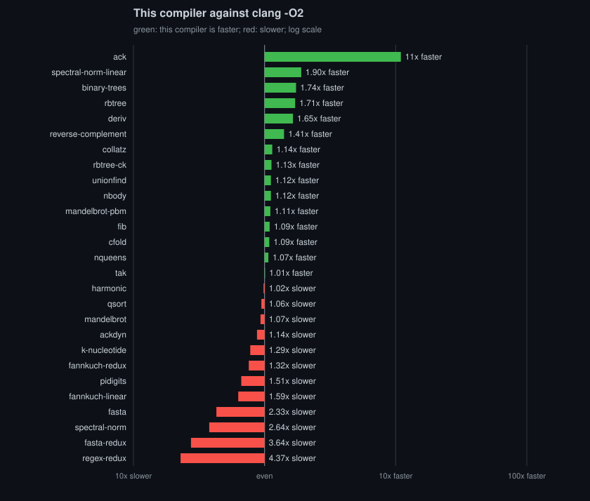

<!-- SPDX-License-Identifier: 0BSD -->
<!-- Copyright (c) 2026 Bjorn Pagen -->
# idris-mlir

A whole-program compiler from Idris 2 to native code through MLIR, where
the types are promises about cost.

High-level code usually gives up control of its costs. This compiler
uses what Idris 2's types already prove to take that control back.
- **Linearity.** A value used exactly once is updated in place, with no
  runtime test.
- **Shapes.** A length the types fix removes the bounds check.
- **Monomorphization.** The whole program is compiled to the code a
  monomorphic program would be: no dictionaries, no uniform boxing.

Each promise holds, or the program is refused with an `unsupported` error
that names the rule and the site. Nothing is miscompiled silently, and
nothing falls back to a slow path.

## How it works

Idris does types; MLIR does programs. Idris checks the program,
monomorphises it and decides each value's representation. The `idr`
dialect, an in-tree MLIR dialect in upstream's layout, does everything
else. Its types carry what Idris proved, `!idr.lin` for a linear value
and `!idr.own` for an owned one, and MLIR's verifier checks them after
every pass.

```text
Idris 2 frontend: check, monomorphise, choose representations
  -> idr dialect: closures and suspensions as regions
  -> isolate, contify
  -> simplify: inline, specialize, canonicalize, to a fixed point
  -> defunctionalize closures into closed sums
  -> stack cells, reference counting with reuse, tail loops
  -> narrow integers, prove indices in bounds
  -> lower to func, memref, linalg and vector; vectorize
  -> LLVM, linked with the runtime as a static executable
```

The function passes run in parallel, on MLIR's own pass manager. Memory is
reference counted, in the style of Lean 4 and Koka: borrowed where a
function only reads, reused where a value dies, on the stack where it
never leaves its frame. The program never runs a tracing collector. A
call in tail position around a cycle of calls is a guaranteed tail call,
so a mutual recursion or an IO loop runs in constant stack.

What sets it apart from Lean 4 and Koka is when reuse is decided. They
test the count at run time, so one extra reference turns an in-place
update into a copy. Quantitative types state linearity in the type, and
the compiler sees every caller. It can prove the update in place before
the program runs, or say why it cannot. A program asks for that proof
with `--demand-in-place`.

## What compiles

Idris 2 programs over the stock Prelude and base, with `main : IO ()`:
- interfaces, resolved at compile time;
- `Integer`, `Nat`, `Double`, strings, lists and `Data.Vect`;
- base's `IOArray` and `Buffer`;
- files, directories, the standard streams, the environment, arguments,
  `System.Clock` and `exitWith`.

Shaped and linear arrays come from the compiler's own package
`libs/mlir-array`, and linear lists and a string iterator from
`libs/mlir-linear`, both written in plain Idris over base's primitives. A construct whose runtime choices no compile-time
analysis bounds is refused. So are `%foreign`, threads, signals and
processes. Every primitive has one meaning, the runtime's, and each
test's committed expected files are its specification.

```sh
make compile SRC=Main.idr OUT=prog
```

## Performance

Measured on arm64 macOS (Apple M2 Max), best of 5 runs, against
clang -O2 and against Idris's own Chez Scheme backend. The latest
record is
[bench/records/2026-10-13-9a1b7b1-darwin-arm64](bench/records/2026-10-13-9a1b7b1-darwin-arm64/results.md):




The programs that trail C are mostly written the way an Idris programmer
writes them first, with `List Char` where the C has byte buffers. The
`Linear.Array` version of spectral-norm beats C. [bench/](bench/README.md)
says how the benchmarks run and how to read a run, and `bench/records/`
holds every kept record.

## Where it is going

The order is fixed in [proposals/](proposals/README.md):
1. **Self-hosting.** The compiler compiles itself, deterministically
   under threads, and the test runner leaves Chez Scheme.
2. **Sharding.** A whole-program compiler that splits its work across
   cores and machines, and a runtime of one shard per core.
3. **Arrays.** A typed array language in the APL tradition, with shapes in
   dependent types, compiled through MLIR's tensor and linalg stack with
   fusion. The compiler itself moves to the array style: its tables, its
   data layouts, and an array interpreter that does compile-time
   normalization.

The one foreign world planned is Rust, through generated runtime
primitives. There is no C interop.

## Setup

Four first-class targets, built by one recipe: arm64 macOS, arm64 Linux
at 16 KiB and at 4 KiB pages, and x86_64 Linux, each linking the system's
C library (libSystem, glibc) and nothing else shared. `make bootstrap`
builds every pinned tool into `.toolchain/`: CMake, Ninja, a two-stage
LLVM and MLIR, GMP, Chez Scheme and Idris 2. Nothing comes from the host
but its C library, a C++ compiler and a few build tools, and nothing
global is modified. The full LLVM build takes hours. `make typecheck` builds only
TableGen and checks that every unit compiles, in minutes.

On Fedora 44, x86_64 or aarch64:

```sh
sudo dnf install -y git make gcc gcc-c++ python3 m4 curl glibc-devel kernel-headers ccache
```

On arm64 macOS, with the Command Line Tools and MacPorts:

```sh
xcode-select --install
sudo port install coreutils ccache
```

Then:

```sh
git submodule update --init
make doctor            # what the host has, and what is built
make check             # the repository's rules, no build
make bootstrap         # the pinned toolchain; slow
make typecheck         # every unit compiles, without the full LLVM
make build             # the compiler, dev preset
make test              # programs, rejections, determinism, toolchain, bench
make test-idr          # the idr dialect, with FileCheck
make test-mlir-tools   # each upstream bug we carry a patch for
make bench             # the benchmarks
make self              # the compiler compiling itself
```

The C++ builds through `CMakePresets.json`: `dev`, `release` (full LTO),
`lint` and `typecheck`. A profile is a run, not a
build: `--time-trace` on the tools, taken by `tools/profile.sh`. `make build PRESET=<name>` picks one.

Each target compiles programs for the CPU its entry in `CMakeLists.txt`
names, and nothing configures another: a program refuses to start on a
processor without that CPU's features. There is no cross-compilation: the toolchain
builds for the machine it is built on, so each target builds on its own
machine, or a VM of it.

## Layout

- `compiler/`: the Idris side, the frontend and `Emit`. `compiler/idris`
  is our fork of Idris's compiler.
- `foreign/idr/`: the `idr` dialect, its passes and the tools, in MLIR's
  `include/` and `lib/` layout.
- `runtime/`: the runtime every program links, and the one meaning of
  every primitive.
- `libs/`: the Idris packages this compiler ships.
- `tests/`: the golden tests, one directory each, all at one level;
  `harness/` runs them and describes them (`harness/README.md`). `bench/`
  holds the benchmarks.
- `proposals/`: designs and the decisions taken on them.
- `upstream/`: the upstream bugs we carry patches for, each ready to file.
- `PINS.md`: every pin, deviation and workaround.
- `sources/`: papers, upstream docs and source snapshots.
- `tools/`: the bootstrap and the compile chain.

## License

[0BSD](LICENSE). The Idris 2 dependency keeps its
[upstream license](third_party/Idris2/LICENSE).
