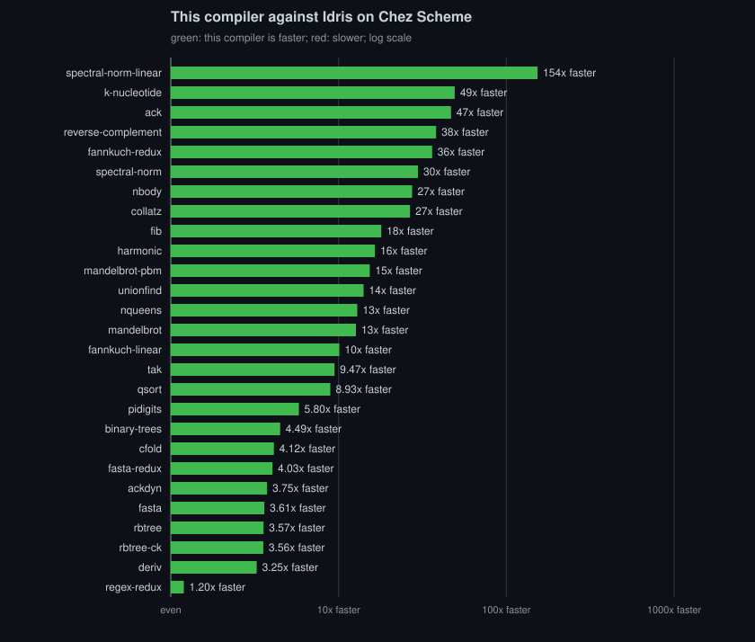
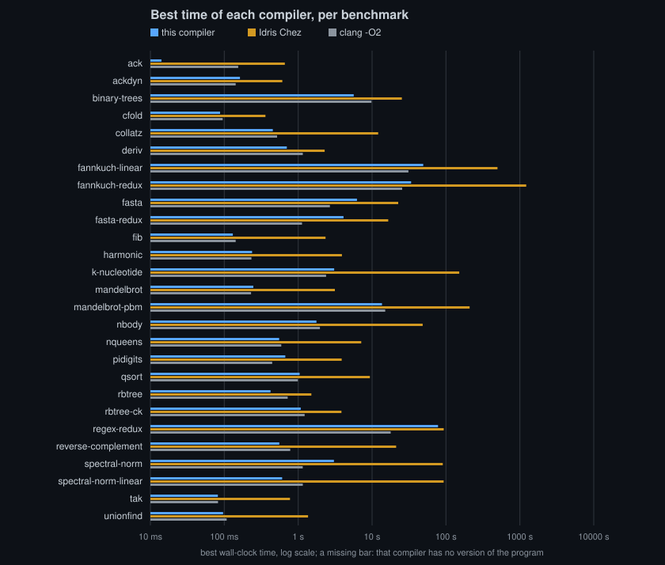

<!-- SPDX-License-Identifier: 0BSD -->
<!-- Copyright (c) 2026 Bjorn Pagen -->
# Benchmarks

`make bench` runs `bench/run.sh`, which builds each program three ways and
runs it on one input (`make bench ARGS='--runs 3 fib tak'` runs fewer):
this compiler on `bench/<name>/Main.idr` (ordinary Idris over the stock
Prelude and base, or over the typed arrays of `libs/mlir-array`, `Array`
and the growable `Linear.Vec`, where `bench/<name>/packages` says so); the
same source through the stock Chez backend (none for a program over
`libs/mlir-array`, whose generating set has no meaning but this compiler's);
and the pinned clang at `-O2`
on `bench/c/<name>.c`, linked
as `idris-mlir --print-link-flags` says the target links a program (a
static PIE on musl, a dynamic executable on Darwin), for this
compiler's target CPU without floating-point contraction, as our programs
are built. Every program runs with the largest stack the system allows
(on macOS the hard limit, about 64 MiB; only cfold needs a deep one, and
it fits). The output starts with what it ran on: the host, its CPU, that
stack limit and each compiler's version.

The script checks that this compiler's program and clang's print the same
numbers (to 1e-9), or the same bytes where the game compares bytes, and
reports the best of the runs in wall-clock seconds, process start included
(about a millisecond). The Chez column is a time and nothing more: its
output is never compared, since what Idris's Chez backend prints is no
specification of a program, and a program it does not run as written reads
n/a. The last column is clang's time over this compiler's: above 1, this
compiler is faster.

## Results

Every record kept here was measured on arm64 macOS: best of 5 runs on an
Apple M2 Max (12 CPUs, 16 KiB pages) on AC power, with the desktop's own
applications running, so not a quiet machine. This compiler targets
apple-m1 there and links dynamic executables with lld; clang's C is built
for the same CPU and linked the same way, and the stack is macOS's 64 MiB
hard limit, which cfold fits.

The one record kept is
[`runs/2026-10-13-9a1b7b1-darwin-arm64`](runs/2026-10-13-9a1b7b1-darwin-arm64/results.md);
its results page holds the full table and the compile times. Of the 27
programs that record measured, against clang -O2 this compiler is faster
on 6, within 15% on 13 and slower on 8 (fannkuch-linear, fannkuch-redux,
fasta, fasta-redux, k-nucleotide, pidigits, regex-redux and
spectral-norm); against Idris on Chez Scheme it is faster on all 27, from
1.2x (regex-redux) to 154x (spectral-norm-linear). Compiling a program
took 0.8 to 5.4 seconds there; k-nucleotide is the slow one.

How to read them. The run-to-run spread on this Mac reaches 15%, so
a ratio within that of 1 is parity. The C column itself moved by up to 2x
between runs on different days (*recalled*, no kept record: rbtree 0.82 s on one, 1.68 s two days
later), so a ratio is read against its own run's C, and records compare by
those ratios, never by seconds. ack runs in milliseconds: it measures the
specialization (Caveats below), not a loop.

A record is what a run measured, kept: `make bench ARGS='--record
bench/runs/<date>-<revision>-<os>-<arch>'` keeps every timed run
(`samples.tsv`), the compile times and what it ran on (`about`), once
every output has agreed. `bench/report.sh RUN PREVIOUS` makes the results
page and the charts from it, and the table `bench/run.sh` prints is that
report's, so the numbers have one source; `tests/bench/records` checks
that every kept record's results are what the report makes.

`profiles/` holds measurements of the compiler itself: its time traces
and dated records of what a measurement found (`profiles/README.md`).

Three kinds of program. **Numeric** (ack, collatz, fib, harmonic,
mandelbrot, nbody, tak): Idris over the stock Prelude, whose interfaces,
literals and `show` resolve at compile time and cost nothing. `mandelbrot`
counts points of the set; the game's program is `mandelbrot-pbm`, which
writes the bitmap. **The Benchmarks Game**, below: the ten programs the
game measures now, at the size it measures, plus `fasta-redux` from the
retired set. `fannkuch-linear` and `spectral-norm-linear` are the same two
programs over the typed arrays (`Linear.Vec` and `Array`), at the same
size. **Counting Immutable Beans' programs** (rbtree, rbtree-ck, cfold,
deriv, nqueens, binary-trees, qsort, unionfind): the Perceus and Lean
papers' benchmarks, written in Idris from the papers' repositories; qsort
and unionfind over `Linear.Vec`. `binary-trees` is both: the game's
program, and that literature's.

### The Benchmarks Game

The ten programs the game measures, and the one retired program added
here. The input is the size the game uses to measure. Each C file is the
single-threaded C entry it follows; where the game's C is threaded, the
table says so. `chameneos-redux` and `thread-ring` are not here: both
require pre-emptive threads (OS threads, or the language's own), and this
compiler has none. `meteor-contest` is not here either. Its board, the
order of the solutions and the limit 2098 are published, and the smallest
solution is the 50-digit string the description prints, but the ten piece
shapes are not on that page. A coordinate list from a later port of the
old solver does not produce that string, so there is no program to add.

| program | input | C entry |
| --- | --- | --- |
| binary-trees | 21 | gcc #1, Kevin Carson. The other C entries are OpenMP or pthreads |
| fannkuch-redux | 12 | gcc #1, the single-threaded count and rotate. gcc #3 (Ledrug Katz) and gcc #8 (Isaac Gouy) are the other single-threaded C entries; gcc #4 is SIMD |
| fasta | 25000000 | gcc #1, a linear search of the cumulative probabilities. The game refuses a scaled lookup; gcc #2, #3 and #8 are that lookup |
| k-nucleotide | fasta 25000000 | no single-threaded C entry. gcc #1 is the only one, and it is OpenMP plus khash. Ours is one core: the sequence packed two bits a nucleotide, counted in an open-addressing table, because a library hash table is what the game asks for and base has none |
| mandelbrot-pbm | 16000 | gcc #8, Greg Buchholz, the single-threaded scalar bitmap. The other C entries are threaded |
| n-body | 50000000 | gcc #1, Christoph Bauer, the symplectic integrator. The C entries are all single-threaded; gcc #4 and #9 add SIMD |
| pidigits | 10000 | gcc #1, GMP, single-threaded. gcc #2 (Oleksii Prudkyi) is the other, also GMP |
| regex-redux | fasta 5000000 | the patterns and the order of gcc #2, Mike Pall, the single-threaded entry. That entry links PCRE; gcc #5 links PCRE2 and is threaded. Ours uses POSIX `regex.h` (macOS libc and musl), and is the slower matcher. No PCRE is pinned |
| reverse-complement | fasta 25000000 | gcc #4, Bob W, single-threaded. gcc #5 (Mr Ledrug) is the other single-threaded C entry; the rest are threaded |
| spectral-norm | 5500 | gcc #8, the only single-threaded C entry. The others are OpenMP |
| fasta-redux | 25000000 | no current C entry; the game no longer measures it. The retired page did not answer here (the live site has no such page, and archive.org did not connect), so the split is the one fasta's own rules still draw: this program indexes a table of every generator residue instead of searching the probabilities. The table is every residue, so the text is fasta's |

`fannkuch-linear` takes 12, like `fannkuch-redux`. `spectral-norm-linear`
takes 5500.

`regex-redux` in Idris carries its own matcher for those patterns: base
has no regex library. The C column calls the system one. The three lengths
are an accumulator: the Prelude's `length` keeps a frame per element, and
the input is longer than the program's stack.

The game's own cutoff for a measured run is several minutes. This suite
kills a run at 1800 seconds, which the official sizes fit: the slowest
are Chez's, fannkuch-redux at about twenty minutes. The sizes are not
shrunk.

### Per program

- **unionfind**: path compression threads the array
  through every `find` and gives it back across a non-tail call. Two
  general changes brought it from 1.4x of C to parity (*recalled*; the kept record is the measurement): an array value is
  its cell and its length, so a bounds check compares two registers
  instead of loading the length from the cell, a load LLVM cannot hoist
  past the stores into that cell; and a result a function always returns
  as one of its arguments is dropped after lowering, so `find` returns its
  record in registers and the write after the recursion needs no second
  check. Nothing in the compiler knows union-find.
- **fannkuch-linear** at about 2x of C (*recalled*; the kept record has 1.59x, measured on the old `LArray` program): the work is the same (the same
  permutations and flips, the same scaling from n=9 to n=11); clang turns
  the C's copy and rotate loops into `memcpy` and `memmove` calls once
  per permutation, on 40 bytes; built with `-fno-builtin` the same C is
  10 to 15% faster than the Idris instead. The C stays as written. The
  Idris compiles to the loop's loads and stores and nothing else.
- **fannkuch-redux** (`IOArray`) against **fannkuch-linear**: the same
  loops, both compiled to the loops' loads and stores. What differs is
  base's representation: an `IOArray` holds `Maybe elem` cells, an
  unboxed tag beside each `Int` at a stride of 16 bytes, so every read
  loads and tests a tag and every write stores one. The same program over
  the raw primitive takes the same time with Idris's range tests
  (0.253 s) as without (0.256 s), and with the `Maybe` cells alone
  0.314 s (*recalled*, no kept record): the tags are the whole gap, the range tests nothing
  measurable, and `Int` has no spare value for `Nothing` that a layout
  could use. The linear version is a `Linear.Vec`, born fresh, whose
  writes One-Shot bufferization puts in place, so its loops are loads and
  stores with no count changed and nothing allocated (the `linarray-*`
  and `ioarray-fannkuch` fixtures state those properties).
- **spectral-norm** (lists) and **spectral-norm-linear**: the typed one
  is written over `Array`'s generating set (`tabulate` and a fold over each
  row). In the 2026-10-13 record, over the linear arrays it was written on
  then, the compiler ran each product with A as one loop nest
  computing four rows at a time on vector lanes, each row's sum in index
  order (the C sums in index order too, so clang does not vectorize it).
  The body's index arithmetic is the program's 64-bit `Int`; the C
  computes its indices in `int`, and idr-narrow-lanes gives each row loop
  a version on 32-bit lanes while n is at most 2^14, the bound the
  analysis of the body's own arithmetic finds, which is where its lead
  over C comes from. The list one rebuilds its lists in their own cells
  and pays for it. The input is the game's 5500.
- **qsort** (parity with C): over `Linear.Vec`, so the partition writes
  in place.
- **rbtree, rbtree-ck, cfold, deriv, nqueens:** persistent trees and terms
  rebuilt on every step, in the cells of the values that die (reset/reuse),
  as the Perceus and Lean papers' versions do, the rest on the stack.
  rbtree-ck keeps the older trees alive, so it measures the allocator under
  a live set.
- **binary-trees:** the C frees through `malloc`; the game's fastest
  C uses a pool. Ours frees each tree as it dies through the runtime's
  allocator, and the bottom level is one static cell.
- **pidigits:** C uses GMP in place; ours allocates a new `mpz` per
  operation and matches it. The in-place form waits for exclusivity on
  bigs.
- **fasta, fasta-redux, reverse-complement:** byte buffers. fasta copies
  the repeated ALU into one doubled buffer and still searches the cumulative
  probabilities in order, which is what the game requires of it; fasta-redux
  loads each random nucleotide from a byte table of every residue.
  reverse-complement complements through a 256-byte table and reverses each
  sequence in place. A line is written from the buffer.
- **k-nucleotide** is the C's algorithm: the sequence is one code byte a
  nucleotide, each fragment a key packed two bits a nucleotide and rolled
  along it, counted in one open-addressing table of the key beside its
  count. The table holds twice as many slots as there are fragments, or
  twice the 4^k possible keys when that is fewer, and an empty slot is a
  zero key, with the same hash as the C (`key ^ (key >> 15)`). The fill of
  a fresh table writes every slot,
  where the C's `calloc` leaves a page untouched until a store.
- **mandelbrot-pbm** builds each row in a `Buffer` and writes it through
  `System.File`, byte for byte as the C does.

## Caveats

- `ack` computes `ack 3 n` with `m` a literal: specialization copies
  `ack` with `m` fixed and LLVM closes three of the copies, so this
  measures the specialization.
- `fib`: LLVM turns one of the two recursive calls into a loop, for this
  compiler and clang alike.
